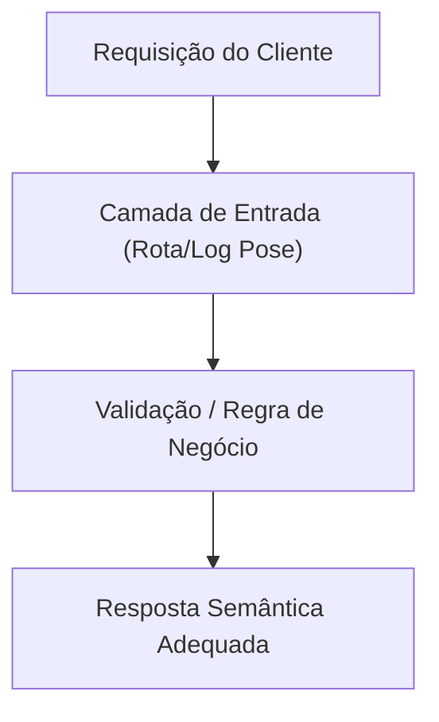

# Diário de Bordo da Grand Line

**Data:** YYYY-MM-DD  
**Arco Atual:** [East Blue | Alabasta | Water 7 | Enies Lobby | Marineford | New World]  
**Conceito Central:** [Nome do Conceito Técnico - Ex: HTTP Status Codes e Streams Nativas]  
**Instrutor:** Silvers Rayleigh  
**Status do Aprendiz:** [Treinando Haki | Pronto para a Próxima Ilha]  

---

## 1. O Conceito Técnico no Backend
[Explicação concisa do fundamento de engenharia de software abordado nesta sessão, destacando por que ele existe e quais problemas resolve no Node.js.]

---

## 2. A Metáfora de One Piece
[A analogia obrigatória com o universo de One Piece. Exemplo:
*"O Nami é a camada de rotas: ela lê o Log Pose e aponta para qual ilha navegar. O Luffy é o Controller: ele decide o que fazer ao pisar em terra firme. Se o Nami tiver que descer do convés e lutar no corpo a corpo com cada pirata que cruzar o caminho, o navio perde a rota e naufraga."*]

---

## 3. O Ponto Cego / Lição Aprendida
[Descrição do vício de código ou equívoco que foi identificado durante a sabatina socrática. **NÃO** coloque o código pronto corrigido; descreva o raciocínio arquitetural correto.]

---

## 4. Diagrama Mental do Fluxo

---

## 5. O Desafio de Fixação Concluído
- **O Desafio:** [Descrição do exercício prático passado pelo Rayleigh]
- **Resultado:** [Como o aprendiz solucionou e justificou a implementação]
