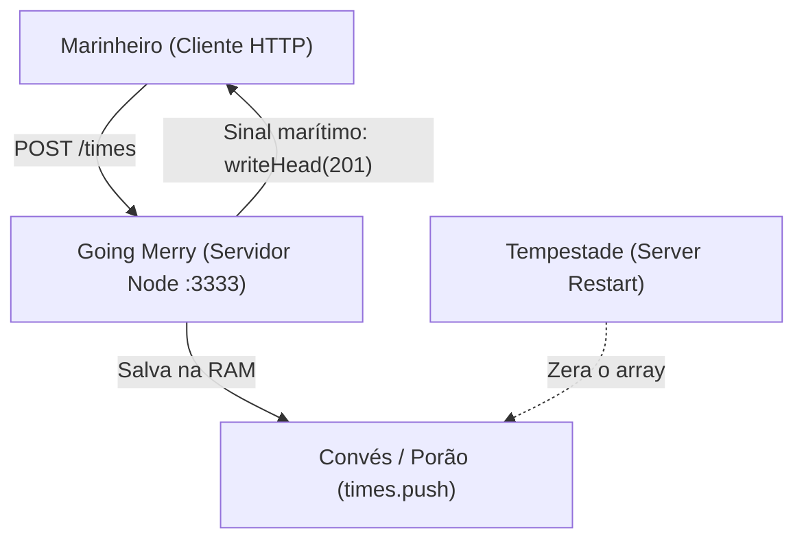

# Diário de Bordo da Grand Line

**Data:** 2026-11-21  
**Arco Atual:** East Blue  
**Conceito Central:** HTTP Nativo, Status Codes Semânticos e Memória em Node.js  
**Instrutor:** Silvers Rayleigh  
**Status do Aprendiz:** Pronto para a Próxima Ilha (Desafio do East Blue Superado)  

---

## 1. O Conceito Técnico no Backend
No Node.js puro (`node:http`), a criação de um servidor lida diretamente com os protocolos de transporte e aplicação da web:
- **Stateful em Memória:** Variáveis globais (como `const times = []`) residem na memória RAM alocada para a instância do processo Node. Se o processo for encerrado ou reiniciar, todo o estado é perdido.
- **HTTP Status Codes:** Comunicação semântica padronizada entre cliente e servidor. 
  - `201 Created`: Informa ao cliente que o recurso solicitado foi criado com sucesso no servidor.
  - `404 Not Found`: Indica que a rota ou recurso requisitado não existe.
- **Metadados e Headers (`setHeader` vs `writeHead`):**
  - `setHeader('chave', 'valor')`: Prepara um cabeçalho HTTP por vez na fila de envio.
  - `writeHead(statusCode, headers)`: Envia explicitamente o Status Code e os cabeçalhos diretamente para a stream de resposta.

---

## 2. A Metáfora de One Piece
> *"O array na memória é como empilhar barris de comida no convés do Going Merry sem amarrar. Enquanto o tempo estiver calmo e o navio navegando, a comida está lá para a tripulação comer. Mas se vier uma tempestade e o navio virar (o servidor cair), toda a comida vai para o fundo do mar.*
>
> *Os clientes que fazem requisições são barcos de marinheiros ancorando no porto: eles não guardam a carga no barco deles; eles pedem para você guardar no seu convés. Se 50 marinheiros pedirem a mesma coisa, você empilhará 50 caixas idênticas no seu próprio porão."*

---

## 3. O Ponto Cego / Lição Aprendida
- **Confusão de Estado e Headers:** Os clientes (navegador, Postman, etc.) não guardam a lista de dados nos seus cabeçalhos. Os dados ficam no servidor. O que trafega nos cabeçalhos são apenas **metadados** (como `Content-Type: application/json` dizendo qual o formato da carta).
- **Semântica Explícita:** No método `GET`, ao usar apenas `setHeader`, o Node assume tacitamente o status `200 OK`. No `POST`, o uso explícito de `writeHead(201)` expressa com clareza a criação do recurso.

---

## 4. Diagrama Mental do Fluxo

---

## 5. O Desafio de Fixação Concluído
- **O Desafio:** 
  1. Tornar explícito o status code `200` no `GET /times` junto ao cabeçalho `Content-Type`.
  2. Implementar IDs incrementais no `POST /times` para que cada inserção tenha uma chave única (`times.length + 1`).
- **Resultado:** O aprendiz ajustou o `src/server.js` com sucesso, encadeando `.writeHead(200)` no `GET` e aplicando `id: times.length + 1` no `POST`. As tábuas do Going Merry estão firmes para continuar a navegação.
