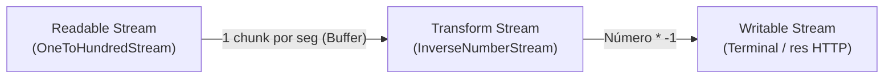

# Diário de Bordo da Grand Line

**Data:** 2026-11-21  
**Arco Atual:** East Blue  
**Conceito Central:** Streams Nativas (Readable, Transform, Writable), Buffers e o Rio de Chunks HTTP  
**Instrutor:** Silvers Rayleigh  
**Status do Aprendiz:** Treinando Haki Avançado (Navegando nos Rios de Dados)  

---

## 1. O Conceito Técnico no Backend
As **Streams** são um dos fundamentos de maior performance do Node.js:
- **Processamento em Chunks:** Em vez de esperar um arquivo de 1GB carregar inteiro na memória RAM para começar a processar, as Streams leem e processam pequenos pedaços (**chunks**) conforme eles chegam pela rede ou disco.
- **Tipos de Streams:**
  - `Readable`: Fonte de dados que emite pedaços (`_read()`, `this.push()`).
  - `Writable`: Destino final que consome dados (`_write()`).
  - `Transform`: Intermediário que altera o pedaço antes de repassar para frente (`_transform()`).
- **Buffers:** Representam pedaços brutos de memória binária alocados fora da V8. Streams trafegam dados exclusivamente em Buffers ou strings.
- **HTTP é Stream:** No Node, `req` é uma `ReadableStream` e `res` é uma `WritableStream`. É possível conectar `req.pipe(transform).pipe(res)`.
- **Node Moderno & Fetch Streaming:** No Node 18+, o envio de stream no `body` via `fetch` exige explicitamente `duplex: 'half'` pela especificação web.

---

## 2. A Metáfora de One Piece
> *"Imagine que o navio precisa descarregar 1.000 barris de pólvora no cais de Water 7.  
> Se você tentar carregar todos os 1.000 barris de uma vez nas costas do Luffy, o navio quebra e o Luffy morre sufocado pela falta de memória.*
>
> *Uma **Stream** é a esteira rolante: você descarrega um barril por segundo. O **Chunk** é o barril individual. O **Buffer** é a madeira do próprio barril onde os dados brutos estão protegidos. E o `.pipe()` é o cano que liga a esteira do navio direto à oficina do Franky!"*

---

## 3. O Ponto Cego / Lição de Sangue (A Batalha do Duplex)
- **Erro:** `[TypeError: RequestInit: duplex option is required when sending a body.]` ao usar `fetch` no Node v24.21.0.
- **Causa:** O Fetch padrão web exige saber se a conexão é unidirecional (`half`) ou bidirecional simultânea (`full`). Como o HTTP/1.1 envia primeiro a requisição para depois ler a resposta, declarar `duplex: 'half'` é obrigatório para streams.

---

## 4. Diagrama Mental do Fluxo

---

## 5. O Desafio de Fixação Concluído
- **O Desafio:** Criar uma Stream de Leitura (1 a 100), passar por uma Transformação (inverter sinal numérico) e enviar como stream contínua via requisição HTTP `POST` para um servidor Node consumi-la em tempo real.
- **Resultado:** O aprendiz superou o erro moderno do Node 24 (`duplex: 'half'`), fez o streaming funcionar de ponta a ponta na porta `3334` e compreendeu a física dos Buffers.
