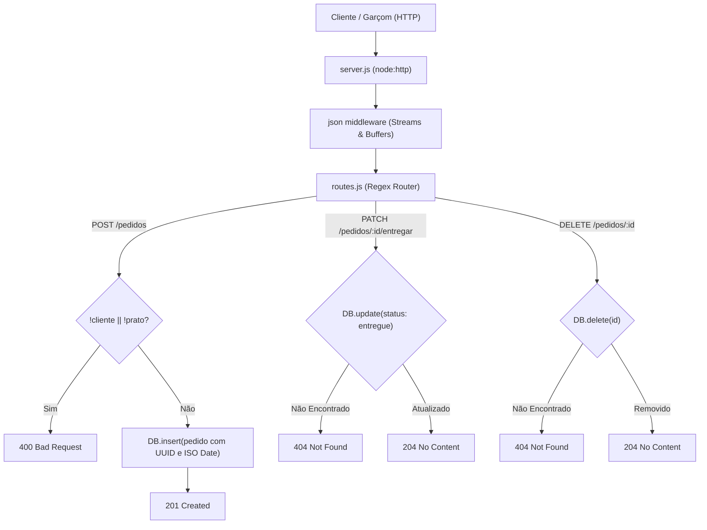

# Diário de Bordo da Grand Line

**Data:** 2026-11-22  
**Arco Atual:** East Blue (Finalizado!)  
**Conceito Central:** Boss Fight 01 — Sistema de Comandas do Restaurante Baratie (API 100% Nativa em Node.js)  
**Instrutor:** Silvers Rayleigh  
**Status do Aprendiz:** VITORIOSO! Passaporte carimbado para a Reverse Mountain rumo a Alabasta!  

---

## 1. O Conceito Técnico no Backend
A conclusão da primeira Boss Fight consolida a capacidade do engenheiro de construir uma API REST completa sem nenhuma dependência externa (zero frameworks), dominando os pilares fundamentais da plataforma Node.js:
1. **Servidor HTTP Nativo (`node:http`):** Manipulação de streams de entrada e saída.
2. **Ciclo de Middleware:** Interceptação assíncrona para resolução de buffers e parser JSON com cláusula `try/catch`.
3. **Roteamento Customizado com Expressões Regulares:** Casamento dinâmico de paths, extração de route parameters nomeados (`:id`) e parser de query strings.
4. **Persistência Assíncrona e Atômica:** Separação entre dados em memória RAM e gravação permanente no disco com `node:fs/promises`.
5. **Semântica e Resiliência HTTP:** Implementação rigorosa de códigos semânticos (`200 OK`, `201 Created`, `204 No Content`, `400 Bad Request`, `404 Not Found`).

---

## 2. A Metáfora de One Piece
> *"O East Blue ficou para trás. O Going Merry resistiu aos ataques do Don Krieg e provou o seu valor no Restaurante Baratie. O Chefe Zeff exigiu disciplina na cozinha: se a comanda chega vazia, ela é rejeitada na hora (`400 Bad Request`); se o pedido é concluído, o prato é servido com elegância (`204 No Content`); e se alguém tentar cancelar uma mesa inexistente, o garçom sabe dizer a verdade (`404 Not Found`). O capitão aprendeu a não depender de atalhos e agora tem o Haki necessário para navegar por qualquer tempestade na Grand Line."*

---

## 3. O Ponto Cego / Lições Superadas na Batalha
1. **Preservação de Estado no PATCH (Object Merging):** No método `update()`, a simples substituição por `{ id, ...data }` apagaria dados prévios do pedido (como `cliente` e `prato`). A correção com spread da linha existente `{ ...row, ...data }` garantiu a integridade de atualizações parciais.
2. **Retorno Booleano de Persistência:** A comunicação honesta entre a camada de dados (`database.js`) e a camada de entrega (`routes.js`) permitiu identificar registros inexistentes e responder com status `404` em vez de silenciar falhas.
3. **Validação Estrita de Entrada:** A substituição da comparação ingênua de booleanos pela verificação Truthy/Falsy (`!cliente || !prato`) blindou a rota contra payloads inválidos.

---

## 4. Diagrama Mental do Sistema Baratie

---

## 5. O Desafio de Fixação Concluído
- **A Boss Fight:** Implementar o sistema autônomo do Baratie cumprindo todos os RFs, RNs e RNFs definidos no [SPEC.md](../missoes/01-east-blue/SPEC.md).
- **Resultado:** Aprovado com louvor pelo mentor Silvers Rayleigh. Recompensa elevada para ฿ 45.000.000 Berries e Haki do Conquistador despertado!
