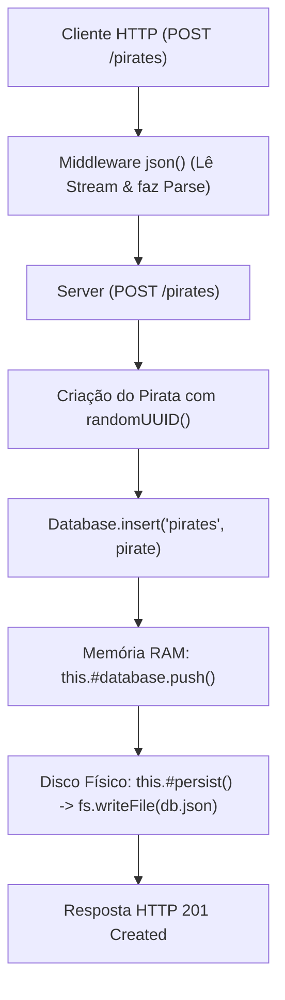

# Diário de Bordo da Grand Line

**Data:** 2026-11-22  
**Arco Atual:** East Blue (Fundamentos Nativos de Node.js)  
**Conceito Central:** Persistência em Disco com `node:fs`, Estado em Memória vs Arquivo Físico e IDs Únicos com `randomUUID`  
**Instrutor:** Silvers Rayleigh  
**Status do Aprendiz:** Pronto para a Próxima Ilha (Rumo às Rotas e Parâmetros)  

---

## 1. O Conceito Técnico no Backend
A memória RAM de um processo Node.js é **volátil**: se o processo for reiniciado, morrer por um erro não tratado ou sofrer um deploy, qualquer dado que resida apenas em estruturas de dados em memória (`#database = {}`) é completamente perdido.

Para garantir a **durabilidade** mínima das informações sem o custo de um SGBD externo no East Blue, utilizamos o módulo nativo **`node:fs/promises`** para persistir o estado em um arquivo físico (`db.json`).

Além disso, a geração de identidades únicas para registros nunca deve depender do tamanho do array (`array.length + 1`), pois remoções causam colisões de chave e IDs sequenciais expõem vulnerabilidades de enumeração (IDOR). O padrão moderno do Node.js é utilizar o algoritmo UUID v4 através da função nativa **`randomUUID()`** do módulo **`node:crypto`**.

---

## 2. A Metáfora de One Piece
> *"A memória RAM é a cabeça do Luffy: cheia de ideias e memórias imediatas, mas basta ele levar uma pancada ou dormir que esquece tudo. O arquivo físico (`db.json`) é o Livro de Registro e os Cartazes de Recompensa da Marinha: mesmo que o navio afunde ou o capitão durma, o papel físico guardado no cofre continua lá intacto. O método `#persist()` é o escriba do navio: se o capitão apenas disser de boca que contratou um novo pirata (`insert`), mas não mandar o escriba riscar a pena no papel, o pirata nunca constará no registro oficial da frota."*

---

## 3. O Ponto Cego / Lição Aprendida
Durante o desenvolvimento do cofre (`Database`), dois pontos cegos críticos foram superados:
1. **O Descompasso Memória vs Disco:** O método `insert()` atualizava o objeto `#database` na memória RAM, mas não invocava `#persist()`. Como consequência, as chamadas HTTP retornavam sucesso `201`, mas o arquivo `db.json` permanecia vazio. A lição: operações que alteram estado precisam invocar explicitamente o gatilho de persistência.
2. **Identidade Sequencial Frágil:** A tentativa de gerar IDs baseados em `length + 1` gerou um `ReferenceError` e falharia diante de exclusões. A substituição por `randomUUID()` eliminou o acoplamento de contagem e blindou a unicidade dos registros.

---

## 4. Diagrama Mental do Fluxo

---

## 5. O Desafio de Fixação Concluído
- **O Desafio:** Identificar por que `db.json` não gravava o novo tripulante mesmo após a execução de `database.insert()`, e substituir o ID fixo por um identificador universal seguro sem bibliotecas externas.
- **Resultado:** O aprendiz rastreou o fluxo interno do método `insert`, invocou `this.#persist()` para sincronizar a RAM com o disco e adotou `randomUUID()` nativo do `node:crypto`.
