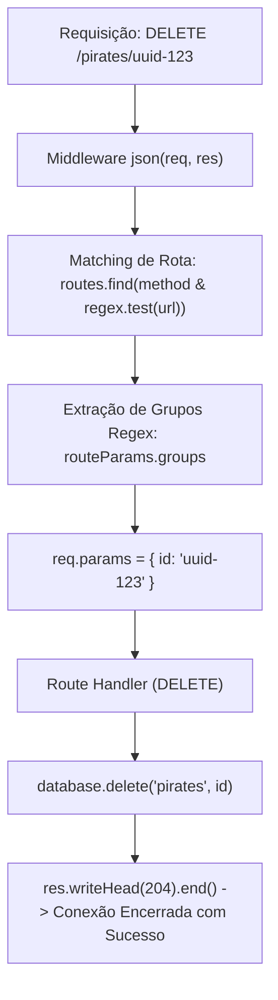

# Diário de Bordo da Grand Line

**Data:** 2026-11-22  
**Arco Atual:** East Blue (Fundamentos Nativos de Node.js)  
**Conceito Central:** A Bússola das Rotas: Route Parameters, Query Parameters e Extração de URL com Regex  
**Instrutor:** Silvers Rayleigh  
**Status do Aprendiz:** East Blue Concluído! Acesso Liberado para a Boss Fight do Baratie!  

---

## 1. O Conceito Técnico no Backend
Em servidores HTTP nativos, `request.url` entrega uma string bruta contendo o path e eventuais parâmetros de busca (ex: `/pirates/c4a8?search=Luffy`).

Diferenciamos três tipos de parâmetros fundamentais no protocolo HTTP:
1. **Route Parameters (`/recurso/:id`):** Identificam um recurso específico no servidor (obrigatórios para operações como `GET /:id`, `PUT /:id`, `DELETE /:id`).
2. **Query Parameters (`/recurso?page=1&search=termo`):** Parâmetros nomeados na URL (iniciados por `?` e separados por `&`), usados para paginação, ordenação e filtros não-obrigatórios.
3. **Request Body:** Carga útil via streams, enviada no corpo da requisição (`POST`, `PUT`), ideal para dados complexos ou sensíveis.

Para estruturar rotas dinâmicas sem frameworks como Express, transformamos paths como `/pirates/:id` em **Expressões Regulares (RegEx)** usando *Named Capture Groups* (`(?<id>[a-z0-9-_]+)`), permitindo casar rotas com precisão cirúrgica e extrair parâmetros diretamente para `request.params` e `request.query`.

---

## 2. A Metáfora de One Piece
> *"O `request.url` é o vento soprando nas velas. Se você tentar navegar com uma rota estrita como `if (url === '/pirates/1')`, o seu navio só sabe ir para uma ilha fixa e bate nas pedras na primeira curva. O `buildRoutePath` com Regex é o **Log Pose da Nami**: ele não grava apenas uma coordenada estática, mas detecta a direção magnética (`:id`) e o clima do mar (`?search=`), ajustando o leme para que o `server.js` encontre o manipulador correto (`handler`) para qualquer ilha que o cliente queira visitar."*

---

## 3. O Ponto Cego / Lição Aprendida
1. **O Perigo do `.end()` Esquecido:** Ao configurar respostas sem corpo (`204 No Content`), é crucial invocar `.writeHead(204).end()`. Esquecer o `.end()` faz com que a stream de resposta (`response`) nunca seja encerrada, mantendo a conexão TCP aberta até estourar timeout no cliente.
2. **Separação de Responsabilidades (SRP):** Retirar a lógica das rotas de dentro do `createServer` e isolá-las em um array modular (`routes.js`) transformou o `server.js` em um orquestrador limpo de middlewares e roteamento.

---

## 4. Diagrama Mental do Fluxo

---

## 5. O Desafio de Fixação Concluído
- **O Desafio:** Modularizar as rotas do servidor em `routes.js`, construir o gerador de regex `buildRoutePath`, implementar a extração de query params e criar operações completas de CRUD (`GET`, `POST`, `PUT`, `DELETE`).
- **Resultado:** CRUD funcional nativo concluído no East Blue com busca por filtros em `database.select`.
